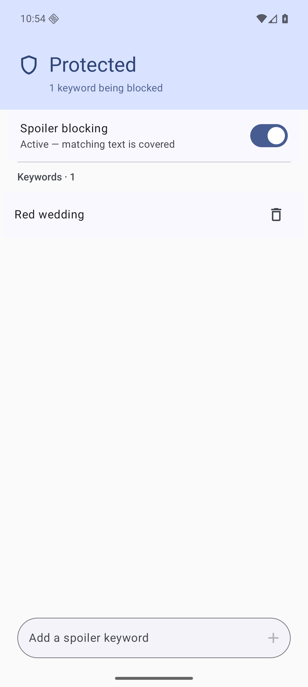
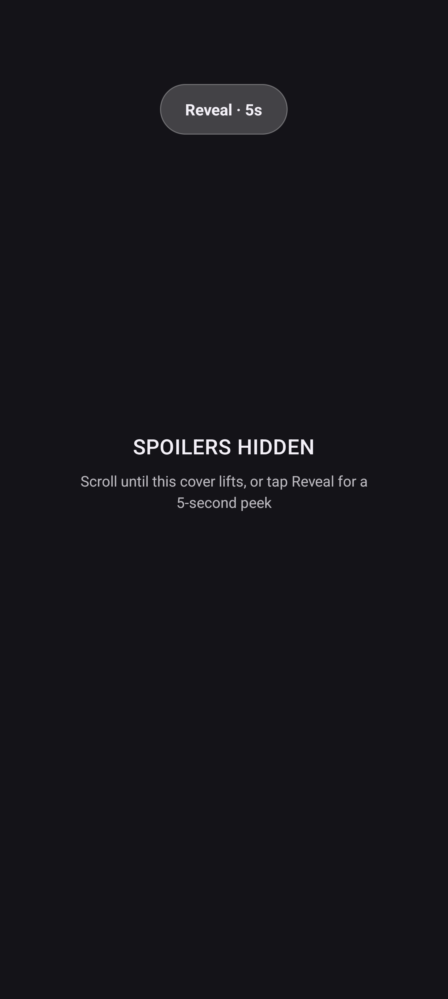
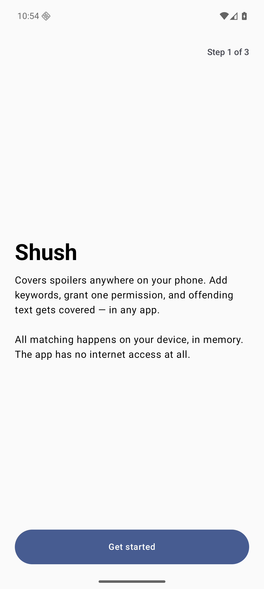
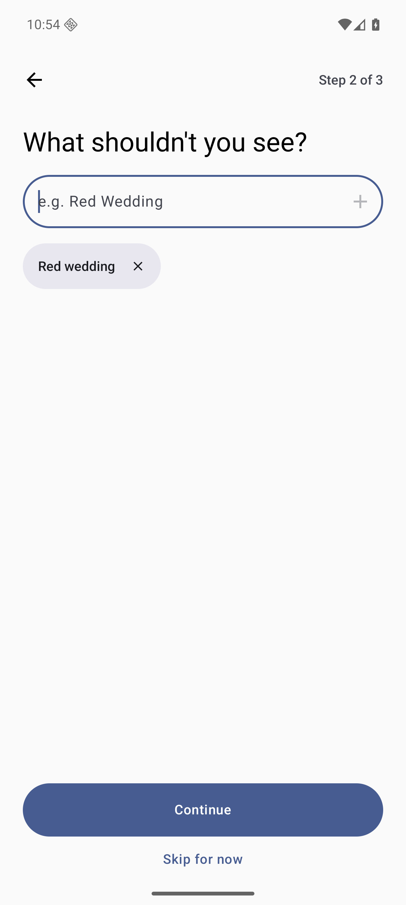
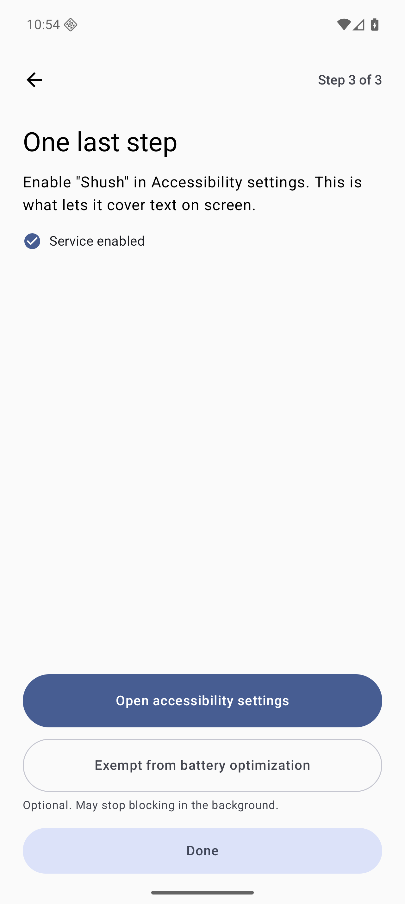
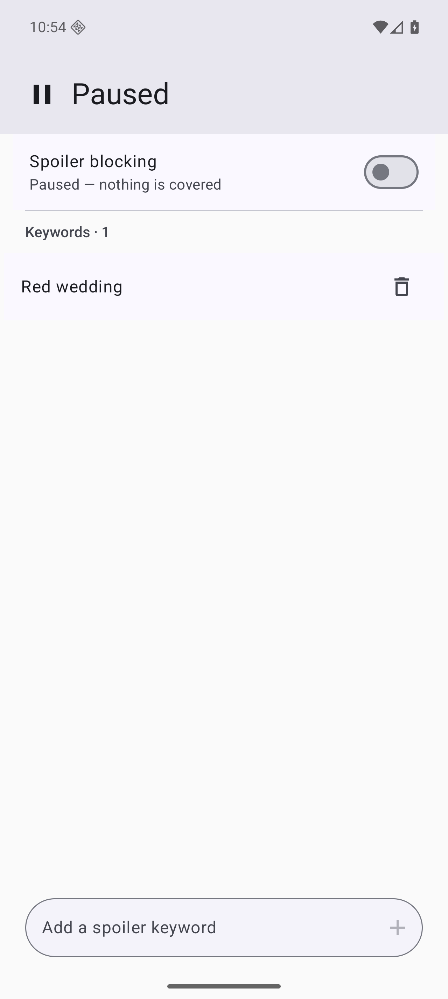

# Shush

**Spoiler protection for everything on your phone.**

Shush watches your screen and covers spoilers before you can see them — in any app: social feeds, chats, browsers, anywhere text appears. Add the names, shows, and plot terms you don't want to see, and Shush quietly hides them. Fully on-device. No internet. No accounts.

<p align="center">
  
  
  
</p>
<p align="center">
  <em>Protected status · Fate of the Red Wedding · Guided setup</em>
</p>

<p align="center">
  
  
  
</p>
<p align="center">
  <em>Keywords as chips · One-permission setup · Pause anytime</em>
</p>

---

## Why

A spoiler can arrive anywhere — a meme, a group chat, a comment section. Shush takes the hit for you: when any of your keywords appears on screen, the whole screen is covered before you can read it. Scroll past the danger and the cover lifts on its own. Tap **Reveal · 5s** if you decide you want to peek.

## Features

- **Blocks everywhere** — any app, any screen, no per-app setup
- **Whole-word matching** — "Red Wedding" matches the phrase, not every "red"; case-insensitive and Unicode-aware
- **Full-screen cover** — no half-hidden lines, no readable context leaking around the edges
- **Scroll to escape** — the cover is touch-transparent: scroll blind until the spoiler leaves the view, and it lifts automatically
- **Reveal · 5s** — a deliberate peek, then it re-covers if spoilers remain
- **Master on/off switch** — pause blocking instantly without touching the permission
- **Keyword management** — add, delete with undo, duplicate detection; casing preserved for display
- **Honest status** — Protected / Paused / Protection off, always reflecting the real state
- **Material You** — dynamic color, light & dark, edge-to-edge

## Privacy by construction

- **No `INTERNET` permission.** Not "we don't upload" — the app *cannot* make a network call. There is no analytics, no crash reporting, no cloud.
- **Nothing stored from your screen.** Text matching happens in memory and is discarded; only your keyword list is persisted, app-private.
- **No backups, no sync.** `allowBackup="false"`; the keyword list never leaves the device.
- **Password fields are skipped** before matching.

## How it works

Shush is an Android **Accessibility Service**. When screen content changes, it scans the visible accessibility tree for your keywords (whole-word, case-insensitive) and draws an opaque overlay with the system's `TYPE_ACCESSIBILITY_OVERLAY` window — no extra "draw over other apps" permission. Scans run immediately on content change (50 ms event batching, 150 ms minimum interval), and pausing switches scanning off entirely.

## Install

1. Download `Shush-v1.0.apk` from the [latest release](../../releases/latest).
2. Open it on your phone and allow installing from this source when prompted.
3. **Play Protect note:** Android may warn that this app "can request access to sensitive data." That warning is standard for sideloaded apps that use an Accessibility Service — the same capability screen readers use, and one that malware often abuses too. Shush has no internet access and its full source is right here.
4. Open Shush, add a keyword or two, and enable the service when prompted.
5. **If the accessibility toggle is greyed out with "Restricted setting"** (Android 13+ anti-malware protection): Settings → Apps → Shush → ⋮ → **Allow restricted settings**, then enable the toggle.

**Requirements:** Android 8.0+ (API 26). Tested on Android 16.

## Known limitations

- **Real text only.** Spoilers baked into images and video frames (memes, subtitles) aren't detected in v1 — OCR is the natural next step.
- **Canvas-rendered apps and games** don't expose text to accessibility, so they can't be matched.
- The cover intentionally lets touches through so you can scroll it away; that means taps on the covered screen reach the app underneath. Deliberate trade-off for the scroll-to-dismiss behavior.

## Build

```bash
# JDK 17+, Android SDK (API 37)
./gradlew assembleDebug      # build
./gradlew testDebugUnitTest  # unit tests (matcher + repository)
```

The app is a single-module Gradle project: Kotlin, Jetpack Compose (Material 3 Expressive), DataStore, and one `AccessibilityService`. The matcher and scanner are pure logic and unit-tested; overlays are plain views managed by the service.

### Project layout

```
app/src/main/java/com/shush/
├── core/        KeywordMatcher (Unicode whole-word matching), NodeScanner
├── data/        KeywordsRepository (DataStore)
├── service/     ShushService (accessibility), StickerOverlayController (cover + pill)
├── ui/          Compose screens (main, onboarding, banner, theme)
└── MainActivity.kt
```

## License

[Unlicense](LICENSE) — dedicated to the public domain. Use it, fork it, ship it, sell it. No attribution required.
